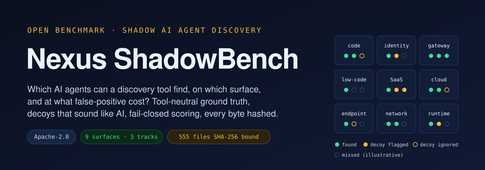
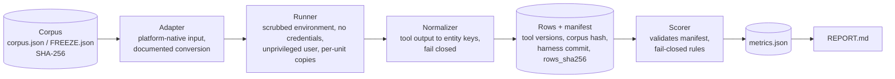

<p align="center"></p>

<p align="center">
<a href="https://github.com/aisecnomad/Nexus-ShadowBench/actions/workflows/ci.yml"></a>
<a href="https://github.com/aisecnomad/Nexus-ShadowBench/actions/workflows/codeql.yml"></a>
<a href="https://scorecard.dev/viewer/?uri=github.com/aisecnomad/Nexus-ShadowBench"></a>
<a href="LICENSE"></a>
<a href="https://www.python.org/downloads/"></a>
<a href="MIGRATION.json"></a>
<a href="#level-1-reproduce-the-published-numbers"></a>
<a href="#limitations-and-the-road-to-independence"></a>
</p>

<p align="center"><strong>An open, reproducible benchmark for tools that discover shadow AI agents.</strong></p>

<p align="center">Code · Identity · LLM gateways · Low-code · SaaS · Cloud and Kubernetes · Endpoints · Network · Runtime</p>

| Repository | What it holds | Scanner it was extracted from |
|---|---|---|
| [`aisecnomad/Nexus-ShadowBench`](https://github.com/aisecnomad/Nexus-ShadowBench) | Corpora, ground truth, harnesses, scorers, tests and every recorded run | [`aisecnomad/Nexus-ShadowScan`](https://github.com/aisecnomad/Nexus-ShadowScan) at [`0792106b`](https://github.com/aisecnomad/Nexus-ShadowScan/tree/0792106b8d2cc09517f7f4ee2eeabf4f8eb8da2d), which pins this repository as its `benchmark-suite` submodule |

> [!IMPORTANT]
> **Read this first.** ShadowBench is not yet independent. The maintainer of
> Nexus ShadowScan, one of the tools under test, wrote the corpora, the labels,
> the harnesses and every other tool's adapter, with AI assistance. The results
> describe how each tool behaves on these inputs. They are not field precision
> or recall, not an independent evaluation and not a verdict on any vendor's
> product, and no letter grades are published. A ShadowScan lead is suspect
> until someone without a stake reruns the benchmark, ideally on their own
> corpus. Everything needed to do that is committed and hashed, and the
> [road to independence](#limitations-and-the-road-to-independence) says what
> is still missing.

## Contents

- [The Why: an open standard for discovery claims](#the-why-an-open-standard-for-discovery-claims)
- [The What: methodology and metrics](#the-what-methodology-and-metrics)
- [The How: the harness and running it accurately](#the-how-the-harness-and-running-it-accurately)
- [Results of record](#results-of-record)
- [Repository layout](#repository-layout)
- [Integrity and provenance](#integrity-and-provenance)
- [Handling the corpus safely](#handling-the-corpus-safely)
- [Limitations and the road to independence](#limitations-and-the-road-to-independence)
- [Documentation](#documentation) · [Community](#community) · [Citation](#citation) · [License](#license)

---

## The Why: an open standard for discovery claims

### The problem

A shadow AI agent is an AI agent, or an AI integration, that runs in an
organization without being in its approved inventory. It rarely lives in one
place. The same coding agent can appear as a `CLAUDE.md` and an `.mcp.json`
in a repository, an OAuth grant in Entra ID, a key alias in a LiteLLM spend
log, a configuration directory in a developer's home, a process on a build
runner and a connection in a Zeek log. A Copilot Studio bot lives in a Power
Platform export; a Bedrock agent lives in an AWS account. Open-source and
commercial discovery tools each read a subset of these places.

Every one of those tools says it discovers AI agents. Today those claims
cannot be compared, and most cannot be checked:

- **No shared ground truth.** Tools are demonstrated on their authors' own
  data. "We found 400 AI apps" says nothing about how many were real, how
  many were missed, or what the tool was shown.
- **No negatives, so no precision.** The vocabulary of AI collides with
  ordinary software: monitoring *agents*, Minecraft *Bedrock* servers, the
  *Gemini* crypto exchange, the MCP2515 CAN-bus controller, apps named
  *copilot*. A benchmark without decoys cannot see false positives, and false
  positives are what an operator pays for in triage time. The recorded runs
  here show the cost in every direction, the benchmark author's own tool
  included: a `gemini` crypto-exchange CLI read as Gemini CLI (17 ShadowScan
  runtime false positives), a `.vscode` directory reported as a coding agent
  in 39 of 40 homes, the Minecraft Bedrock protocol library read as Amazon
  Bedrock.
- **Coverage and accuracy are conflated.** A tool that is precise on
  endpoints and blind to identity looks perfect when scored only where it
  runs, and useless when scored on everything. Buyers need both numbers.
- **Failures hide as clean results.** A scanner that crashed, timed out or
  read half a repository reports nothing, and "nothing" reads as a correct
  negative unless the scorer refuses to credit it.
- **Numbers are not reproducible.** Without pinned inputs, pinned tool
  versions, recorded commands and hashed outputs, a published percentage
  cannot be rechecked by anyone else.

AI governance programs need an inventory of the AI systems an organization
runs, and an inventory is only as good as the discovery behind it. Security
teams choosing a tool, tool authors improving one, researchers studying the
problem and auditors checking an inventory all need the same thing: a common,
open yardstick with published rules.

### What a fair measurement needs, and how ShadowBench provides it

ShadowBench is offered as a **candidate open standard**: its question, data,
rules, harness and results are open so that it can become a standard through
independent replication, not by declaration.

| Requirement | Why it matters | ShadowBench mechanism |
|---|---|---|
| A tool-neutral vocabulary | No tool should be scored against a vocabulary it cannot express | Entity keys are the platforms' own identifiers (Okta app id, Entra `appId`, AWS ARN, `namespace/Kind/name`, home-relative path, `ip:port`, pid); code uses a shared `<category>:<value>` fact taxonomy used by the labeler and every adapter alike |
| Platform-native inputs | No tool is handed another tool's format | Okta and Graph exports, LiteLLM spend logs, Bedrock invocation logs, Power Platform and n8n exports, Slack and GitHub admin exports, AWS CLI and `kubectl` JSON, Zeek logs, osquery rows, real repositories pinned by commit; every conversion is documented in its adapter |
| Negatives that bite | Precision is meaningless without them | Decoys, controls and near-misses drawn from confusions real tools make |
| Auditable ground truth | A label nobody can check is an opinion | Every entity carries evidence pointers; tolerated keys are explicit; label disputes have an [issue form](https://github.com/aisecnomad/Nexus-ShadowBench/issues/new/choose) |
| Fail-closed scoring | Crashes must not masquerade as clean scans | An error, timeout, missing row or incomplete scan never earns a true negative |
| Coverage made visible | In-scope accuracy and whole-estate reach answer different questions | In-scope metrics on declared surfaces, estate recall over every expected entity, and coverage out of nine |
| Uncertainty and paired tests | Twenty cases per modality give wide intervals | Wilson 95% intervals, case-bootstrap F1 intervals and exact McNemar tests |
| End-to-end provenance | Anyone must be able to recheck a number | SHA-256 over corpora, frozen artifacts, result rows and every migrated file; the committed metrics [re-score byte for byte](#level-1-reproduce-the-published-numbers) |
| Disclosure | Trust follows from what is admitted | Conflict-of-interest notes, errata, per-run disclosures and in-sample declarations sit beside every result |
| Open license and process | A standard nobody can fork is a product | Apache-2.0, issue forms for adapters, label errata and result submissions, and a written [governance](GOVERNANCE.md) policy |

### Who it is for

| You are | Use ShadowBench to |
|---|---|
| A security team choosing a tool | See which surfaces each tool covers, what it finds there and what it falsely flags, then rerun it on your own data |
| A discovery tool author | Measure recall and false-positive cost per surface and per input type, and catch regressions |
| A researcher | Study the shadow AI discovery problem on a documented, versioned and hashed corpus |
| An auditor or reviewer | Check a published number from the committed rows, without running any third-party tool |

### What ShadowBench is not

- **Not independent, yet.** See the note at the top.
- **Not field accuracy.** Eight of the cases track's nine surfaces and the
  whole estate are synthetic and author-written; real tenants are larger and
  messier.
- **Not a ranking or a certification.** Tools are measured only on the
  surfaces and modalities they declare, and no grade, tier or recommendation
  is published.
- **Not a place to execute untrusted content.** The corpus is data; see
  [Handling the corpus safely](#handling-the-corpus-safely).

---

## The What: methodology and metrics

The complete definitions are in [docs/methodology.md](docs/methodology.md)
and [docs/metrics.md](docs/metrics.md). Each scorer's module docstring is the
normative rule; this section summarizes it.

### The question and the nine surfaces

*Given what an operator can actually collect from a surface, which AI agents
and which plain AI uses are present, and can a discovery tool find them
without flagging the things that merely sound like AI?*

| Surface | What the tool is pointed at (cases track modalities) |
|---|---|
| code | a repository checkout pinned by commit |
| identity | an Okta app export; Entra ID service principals, applications, grants and role assignments |
| gateway | LiteLLM `/spend/logs` rows; Bedrock model invocation logs |
| low-code | a Power Platform export with Copilot Studio bots; an n8n workflow export |
| SaaS | Slack app approvals, requests and users; a GitHub organization's app installations |
| cloud | AWS CLI JSON (Bedrock Agents, AgentCore, Lambda, SageMaker, IAM); `kubectl get deploy,sts,ds -A -o json` |
| endpoint | a developer home directory, given to the tool as `HOME` |
| network | Zeek `conn`, `ssl`, `dns` and `http` logs; loopback services that answer like the real products |
| runtime | osquery process rows; inert processes spawned under recorded names and command lines |

### Ground truth: labels, decoys and keys

Every expected entity carries a **key**, a **label** and the **evidence**
that justifies it:

| Label or role | Meaning | Examples |
|---|---|---|
| `agent` | an autonomous or tool-using AI agent, or an agent integration | a configured MCP server, a Copilot Studio agent, a Bedrock agent, a coding-agent CLI, an agent-framework process |
| `llm` | AI use without agent evidence | a chat SaaS app, a model server, a single-completion caller, a GPT step in a flow |
| decoy (`none`) | a record with no AI that a tool must leave alone | a monitoring *agent*, a Minecraft *Bedrock* server, an app named *copilot*, a classic chatbot |
| control / near-miss | a negative unit: no AI at all, or AI vocabulary without AI technology | an HTTP client library; a user-agent parser, an MCP2515 CAN-bus library, a Gemini-protocol browser |
| tolerated key | a supporting record a tool may report without credit or penalty | a client's parent directory, an agent's execution role, a lock-file mention |

### Tracks

Three live tracks share the question and differ in what they hold constant.

| Track | Inputs | Ground truth | Size | Integrity check | Harness |
|---|---|---|---|---|---|
| [**Cases**](benchmarks/shadowbench/cases/README.md) | 320 cases generated from written rubrics on eight surfaces, plus 26 public repositories pinned by commit | Per-case entities labeled `agent` or `llm`, tolerated keys and decoys | 346 cases, 738 expected entities, 735 decoys | `verify` rebuilds every case from the generator | [`tools/shadowbench/cases/`](tools/shadowbench/cases/README.md) |
| [**Estate**](benchmarks/shadowbench/estate/README.md) | One authored fictional organization, Adatum Logistics, across all nine surfaces at once | 137 entities (87 positive, 27 control, 23 near-miss) with facts, evidence pointers and anchors | 104 expected facts, 139 frozen files | `verify-freeze` checks every file against `FREEZE.json` | [`tools/shadowbench/estate/`](tools/shadowbench/README.md) |
| [**Code surface**](benchmarks/shadow-ai-discovery/README.md) | 87 public repositories (84 GitHub, 3 GitLab) pinned by commit | `<category>:<value>` facts with `kind:path[:line]` evidence | 65 positive, 10 control, 12 near-miss; 839 expected facts in 8 categories | `fetch --verify` checks every pin | [`tools/discovery_benchmark/`](tools/discovery_benchmark/README.md) |

Six earlier benchmarks and one unverified archive are preserved with their
original protocols; [docs/results.md](docs/results.md) lists them all.

### Outcomes: TP, FP, FN and TN

Outcomes are counted per **entity** (cases and estate), per **fact** (code
surface and the estate's value level) and per **case** or **repository**.
A tool's own notion of a finding is used: no confidence threshold is imposed
on top of what it reports at its defaults.

| Outcome | Entity level | Case level |
|---|---|---|
| **True positive (TP)** | A reported key matches an expected entity's key (for home-directory artifacts, a reported path inside the expected directory also matches; never an ancestor directory) | A positive case where the tool reported at least one expected entity |
| **False positive (FP)** | A reported key matches nothing expected or tolerated; a hit on a decoy also counts against specificity | A negative case where the tool reported any false positive (on code, anything outside the fact taxonomy) |
| **False negative (FN)** | An expected entity the tool did not report, including every expected entity of an `error` or missing row | A positive case with no true positive, including errors |
| **True negative (TN)** | A decoy left alone **on a complete `ok` run only** | A negative case scanned completely with no false positive |
| *Neither* | Tolerated keys; on code, keys outside the fact taxonomy (counted apart as `out_of_taxonomy`) | Negative cases whose every decoy the tool's adapter withheld |

### Metrics

| Metric | Definition | Question it answers |
|---|---|---|
| Precision | TP / (TP + FP) | When the tool says "AI here", how often is it right? |
| Recall (sensitivity) | TP / (TP + FN) | Of the AI present on the surfaces the tool runs, how much does it find? |
| F1 | 2·TP / (2·TP + FP + FN), from counts | One balance of precision and recall |
| Specificity | TN / decoys in the universe (decoys of error and incomplete rows stay in the denominator) | How often does the tool leave non-AI look-alikes alone? |
| Balanced accuracy | (case recall + case specificity) / 2 | Case-level accuracy that does not reward a skewed class mix |
| MCC | (TP·TN − FP·FN) / √((TP+FP)(TP+FN)(TN+FP)(TN+FN)), case level | One correlation between the tool's verdicts and the truth, from −1 to 1 |
| Agent-tier recall | expected `agent` entities the tool reported **as agents** / expected agents | Can the tool tell agents from plain AI use? A tool that only says `ai` earns no agent-tier credit |
| Agent false-alarm rate | `llm` entities and decoys the tool called agents / that universe | How often does it over-escalate? |
| Estate recall | TP / every expected entity in the corpus, on every surface | How much of the whole problem does the tool cover? Unsupported surfaces count as missed |
| Coverage | surfaces with at least one case run, out of nine | Where does the tool look at all? |
| Shadow layer (estate) | registered entities read as registered, unregistered positives read as shadow | Does the tool reconcile findings against a supplied agent registry? |

**Uncertainty.** Precision, recall and specificity carry Wilson 95% score
intervals. F1 carries a 2,000-sample case-bootstrap percentile interval
(fixed seed, so it is reproducible). Tools are compared with an exact,
two-sided McNemar test on case-level correctness over the cases both ran.
**Timing** (median, p90 and maximum seconds per `ok` case) is indicative
only, because cases run in parallel.

**In scope versus estate-wide.** In-scope metrics count only the surfaces
and modalities a tool declares, so a narrow tool is not penalized for what it
does not claim; estate recall charges every tool for the whole corpus, so
coverage is not hidden. Read both.

### Fail-closed rules

| Situation | How it is scored |
|---|---|
| Crash, timeout or unreadable output (`error`) | Every expected entity is missed; decoys stay in the specificity denominator but earn no TN; a positive case is missed and a negative case is a false alarm |
| No row for a case (missing) | Counted as an error and reported as missing, unless the tool does not run that surface and modality |
| Incomplete scan (for example ShadowScan exit 3) | Keeps the TPs and FPs it reported; never earns a TN; a negative case scanned incompletely is a false alarm; counted separately |
| Surface or modality the tool does not declare (`unsupported`) | Left out of in-scope metrics; counted as missed in estate recall |
| Decoys whose records an adapter's conversion never passes to the tool (`withheld_decoys`) | Left out of that tool's specificity and agent false-alarm denominators, unless the tool reports one anyway |
| Results the run manifest does not vouch for (wrong corpus hash, unknown file, wrong row counts or digest) | Refused unless `--force`; a forced score records every override in `metrics.json` and at the top of the report |

The estate scorer is stricter still: an incomplete or missing run leaves
every entity it reaches unscored, so it earns nothing. The code-surface
scorer keeps an incomplete run's facts as a lower bound and marks its cells
`(incomplete)`. [docs/metrics.md](docs/metrics.md) tabulates the
differences.

### A worked example

One tool, one modality, four cases (simplified: no tolerated keys, no
agent tier):

| Case | Truth | Tool outcome | Entity outcomes | Case outcome |
|---|---|---|---|---|
| A, positive | expected `a1 a2 a3`; decoys `d1 d2` | `ok`, reports `a1 a3 d1` | TP 2 (`a1 a3`), FN 1 (`a2`), FP 1 (`d1`), TN 1 (`d2`) | found |
| B, negative | decoys `d3 d4` | `ok`, reports nothing | TN 2 | correct negative |
| C, positive | expected `a4`; decoy `d5` | timeout (`error`) | FN 1; `d5` in the denominator, not a TN | missed |
| D, negative | decoy `d6` | incomplete scan, reports nothing | `d6` in the denominator, not a TN | false alarm |

Entity level: TP 2, FP 1, FN 2, TN 3 of 6 decoys. Precision 2/3 = 67%
(Wilson 21–94%), recall 2/4 = 50% (15–85%), F1 = 4/7 = 57%, specificity
3/6 = 50% (19–81%). Case level: recall 1/2, specificity 1/2, balanced
accuracy 50%, MCC 0. A scorer that read the timeout and the incomplete scan
as clean would have reported specificity 4/6 and a perfect case-level
negative record. If the corpus held 10 expected entities across all
surfaces, estate recall would be 2/10 = 20%.

---

## The How: the harness and running it accurately

[docs/harness.md](docs/harness.md) describes every module and file format;
[docs/running.md](docs/running.md) is the full operator guide.

### Architecture



Each track keeps its own corpus model, adapters, runner and scorer.

| Track | How a tool is run |
|---|---|
| Cases | Each case is materialized in a scratch tree; loopback mock services or inert processes start when the case needs them; the tool runs as uid/gid 65534 with `no_new_privs` in fresh network, PID, mount and IPC namespaces, with `/root` and `/home` hidden, a case-local `HOME`, no inherited credentials and no network beyond loopback |
| Estate | Each unit runs against its own copy of the frozen estate, checked against `FREEZE.json` before and after; the environment is rebuilt from scratch with a private `HOME` and `TMPDIR`, telemetry opt-outs and a dead proxy; `--as-user` drops to an unprivileged account |
| Code surface | Every tool gets the same read-only checkout; with `--as-user` it runs through `setpriv` with a rebuilt environment, a dead proxy, a private `HOME` and a per-run timeout |

These measures reduce what a tool can reach. None of them is a sandbox, so
third-party tools run only on a disposable, externally isolated host with
egress disabled and no credentials.

### Requirements

| To | You need |
|---|---|
| Verify evidence and re-score committed runs | Linux (CI runs Ubuntu), Python 3.11 to 3.14, the hash-locked environment below. No third-party tool and no network after installation |
| Run the test suite | The above plus Nexus ShadowScan at the pinned commit; some tests start loopback servers and subprocesses |
| Run discovery tools against a track | A disposable, externally isolated Linux host with no credentials and the tools at the versions each track pins; the cases runner also needs root (namespaces via `unshare`) and `gcc` for the inert process binary |

Set up the environment once:

```bash
git clone https://github.com/aisecnomad/Nexus-ShadowBench.git && cd Nexus-ShadowBench
git clone --filter=blob:none --no-checkout https://github.com/aisecnomad/Nexus-ShadowScan.git scanner-source
git -C scanner-source checkout --detach 0792106b8d2cc09517f7f4ee2eeabf4f8eb8da2d
python -m venv .venv && . .venv/bin/activate
python -m pip install --require-hashes --only-binary=:all: \
    -r requirements.lock -r requirements-ci.lock -r requirements-build.lock
python -m pip install --no-deps --no-build-isolation -e ./scanner-source
```

From a ShadowScan checkout the same repository is the `benchmark-suite`
submodule: `git submodule update --init --depth 1 -- benchmark-suite`, then
`python -m tools.benchmark_suite`.

### Level 0: verify the evidence

Integrity only. Nothing is executed from the corpus, and no tool runs.

```bash
python -m tools.verify_migration          # 555 files: bytes, mode, Git blob, SHA-256 and recorded amendments
python -m tools.shadowbench cases verify --corpus benchmarks/shadowbench/cases/corpus.json
python -m tools.shadowbench estate validate
python -m tools.shadowbench estate verify-freeze
python -m tools.shadowbench450_archive    # arithmetic-only check of the unverified archive
```

`cases verify` rebuilds all 346 cases from the generator and compares them;
it reports that the generator sources changed since the corpus was written
but build identical cases. `estate validate` reports 137 entities and 12
known anchor-collision warnings and exits 0. `verify-freeze` checks 139
files.

### Level 1: reproduce the published numbers

Scoring needs no third-party tool, so anyone can recompute the committed
metrics from the committed rows:

```bash
out=$(mktemp -d)
python -m tools.shadowbench.cases score --corpus benchmarks/shadowbench/cases/corpus.json \
    --results benchmarks/shadowbench/cases/results/2026-10-11 --out "$out/cases.json"
cmp "$out/cases.json" benchmarks/shadowbench/cases/results/2026-10-11/metrics.json

python -m tools.shadowbench.estate score \
    --runs benchmarks/shadowbench/estate/results/2026-10-11/runs.json --out "$out/estate.json"
cmp "$out/estate.json" benchmarks/shadowbench/estate/results/2026-10-11/metrics.json

python -m tools.discovery_benchmark score --corpus benchmarks/shadow-ai-discovery/corpus.json \
    --runs benchmarks/shadow-ai-discovery/results/2026-10-09/runs.json --out "$out/code.json"
cmp "$out/code.json" benchmarks/shadow-ai-discovery/results/2026-10-09/metrics.json
```

All three `metrics.json` files reproduce byte for byte at the current
commit, and so do the cases and estate `REPORT.md` files (render them with
each track's `report` command). [docs/results.md](docs/results.md) records
the one known rendering difference in the code-surface report.

### Level 2: run tools against a track

Run third-party tools only on a disposable, externally isolated machine with
no credentials. Each track's harness README has the complete procedure:

| Track | Install | Run | Score and report |
|---|---|---|---|
| Cases | `bash tools/shadowbench/cases/install_tools.sh /opt/nsb/tools` | `sudo python -m tools.shadowbench.cases run --corpus … --tools /opt/nsb/tools/tools.json --checkouts /opt/nsb/checkouts --out /opt/nsb/results --workers 3` | `cases score`, then `cases report` |
| Estate | the versions in `runs.json` `tool_versions` | `python -m tools.shadowbench.estate run --tools tools.json --out runs/ --workers 4` | `estate score --runs runs/runs.json`, then `estate report` |
| Code surface | the versions in `results/<run>/tools.json` | `python -m tools.discovery_benchmark fetch …`, then `run … --as-user bench --workers 4` | `score`, `report`, and `compare` as a regression gate |

In the cases track the ShadowScan entry in `tools.json` names a scanner
checkout (`"repo"`), whose commit the adapter records; the estate and
code-surface tracks call an installed `shadowscan` binary (`"bin"`), so
record which commit you installed (the 2026-10-11 estate run did not, and
says so). Current runners also record the harness commit and whether
anything under `tools/` differed from it.

### Level 3: test for overfitting

The committed corpora are in-sample for ShadowScan, whose rules were changed
after the 2026-10-11 runs with their errors in view. To measure anything new:

```bash
python -m tools.shadowbench.cases generate --seed <your seed> --per-surface 40 --output fresh.json
python -m tools.shadowbench.cases verify --corpus fresh.json   # must print stream scheme sha256 and no shared streams
```

Better still, author your own estate or relabel the code surface without
looking at any tool's output, and publish it as an independent corpus
([docs/submitting-results.md](docs/submitting-results.md)).

### Accuracy checklist

- [ ] Record both repository commits, the scanner commit, every tool version
      and the lock files for every run.
- [ ] Write every new run to a **new dated directory**; never overwrite a
      historical result or refresh a freeze to hide drift.
- [ ] Never use `--force` for a published result, and never `--stream-scheme
      legacy` for a new corpus.
- [ ] Calibrate adapters on a smoke corpus at another seed, never on the
      scored corpus; commit adapters before the scored run.
- [ ] Use each tool's defaults; give no tool an allowlist, inventory or
      known-agent list.
- [ ] Keep raw tool output on the run host so the mapping can be audited.
- [ ] Declare in-sample status, isolation level, incomplete runs and who
      authored the corpus, labels and adapters next to the numbers.
- [ ] Do not run the legacy `tools/benchmark` and `tools/benchmark_realworld`
      installers, freeze helpers or self-checks from this repository: they
      assume the scanner and harness share one root, so reproduce them in the
      pinned `scanner-source` checkout and never read this repository's
      commit, or an empty scanner-tree hash, as a scanner revision.

---

## Results of record

The cases and estate results below are re-scores of committed rows with the
current scorers and reproduce byte for byte. Read the caveats first:
author-written corpora,
author-written adapters, rows recorded under weaker isolation than the
current runner's, scoring rules revised after the runs with their results in
view, and later ShadowScan runs on these corpora are in-sample.

**Cases track, 2026-10-11** ([report](benchmarks/shadowbench/cases/results/2026-10-11/REPORT.md)).
Each tool ran only on the surfaces and modalities it declares. No run
crashed or timed out and no row is missing.

| Tool (version) | Coverage | Cases run | Estate recall | In-scope TP / FP / FN / TN | In-scope P / R / F1 (F1 95% CI) | Decoy specificity | Case balanced accuracy | Case MCC |
|---|---|---|---|---|---|---|---|---|
| ShadowScan (0.1.2+2d43f508fc95) | 9/9 | 326 | 84% (619/738) | 619 / 176 / 87 / 421 | 78% / 88% / 82% (80–85) | 63% | 76% | 0.59 |
| AgentDiscover (2.9.5) | 2/9 | 66 | 4% (26/738) | 26 / 1 / 107 / 0 | 96% / 20% / 32% (20–42) | n/a | 62% | 0.30 |
| AI-Infra-Guard (v4.6.5) | 1/9 | 20 | 4% (26/738) | 26 / 0 / 6 / 50 | 100% / 81% / 90% (84–96) | 100% | 100% | 1.00 |
| SafeDep vet (v1.20.0) | 2/9 | 66 | 2% (17/738) | 17 / 39 / 116 / 0 | 30% / 13% / 18% (10–27) | n/a | 37% | −0.26 |
| Microsoft `agent-discovery` (5.0.0) | 3/9 | 86 | 2% (15/738) | 15 / 2 / 166 / 81 | 88% / 8% / 15% (8–23) | 100% | 60% | 0.25 |
| Fleet `ai_tools` table (cf1217b) | 2/9 | 60 | 2% (14/738) | 14 / 2 / 58 / 81 | 88% / 19% / 32% (18–46) | 100% | 62% | 0.29 |
| Snyk Agent Scan (0.6.8) | 1/9 | 40 | 1% (7/738) | 7 / 0 / 17 / 0 | 100% / 29% / 45% (21–65) | n/a | 65% | 0.38 |
| Cisco MCP Scanner (4.8.6) | 1/9 | 40 | 0% (1/738) | 1 / 0 / 23 / 0 | 100% / 4% / 8% (0–25) | n/a | 52% | 0.13 |
| Numbat (77ece3a) | 1/9 | 40 | 0% (1/738) | 1 / 0 / 23 / 0 | 100% / 4% / 8% (0–24) | n/a | 52% | 0.13 |

Specificity is `n/a` where the cases a tool ran hold no decoys. ShadowScan's
specificity leaves out 17 AWS IAM-role decoys its adapter never passes to it,
and 27 of its scans were incomplete. AI-Infra-Guard's clean decoy record is
against mock services whose answer to unknown paths was not fixed blind.
Estate recall rewards coverage, and
ShadowScan is the only tool that declares all nine surfaces; its maintainer
also wrote the rubrics that decide what counts.

**Estate track, 2026-10-11** ([report](benchmarks/shadowbench/estate/results/2026-10-11/REPORT.md)).
ShadowScan 0.1.2 detected 83 of 87 positives and flagged 8 of 50 in-scope
negatives (value P / R / F1 92% / 95% / 93%); no other tool flagged a
control or near-miss, partly because 36 of the 50 negatives sit on surfaces
only ShadowScan declares. Read disclosures [a] to [e] in the
[estate README](benchmarks/shadowbench/estate/README.md) before using any
other tool's row.

**Code surface, 2026-10-08** ([report](benchmarks/shadow-ai-discovery/results/2026-10-08/REPORT.md)).
Nine tools on 87 pinned repositories; ShadowScan 0.1.2 had in-scope value
P / R / F1 97% / 86% / 91% and the next tool, NuGuard, 96% / 62% / 75%. That
report was scored against the labels as first published; re-normalized with
the fixed adapters and re-scored against the revised labels (corpus v2),
ShadowScan's F1 is 92.3% and every other tool moves by at most 0.2 points.
The 2026-10-09 ShadowScan re-run (in-scope
value F1 97.2%), whose `metrics.json` reproduces byte for byte, followed
changes driven by this corpus and measures fit to it, not field accuracy.

[docs/results.md](docs/results.md) indexes every run of record, historical
run and archive, with its status.

---

## Repository layout

```text
.
├── benchmarks/                  corpora, ground truth and committed results (byte-locked)
│   ├── shadowbench/cases/       cases track: corpus.json, results/<date>/
│   ├── shadowbench/estate/      estate track: corpus.json, FREEZE.json, artifacts/, results/<date>/
│   ├── shadow-ai-discovery/     code-surface track: corpus.json, results/<date>/
│   ├── realworld/ sab_realworld/ sab-holdout/   earlier benchmarks
│   └── shadowbench-450/         unverified archive: counts only, no runnable benchmark
├── tools/
│   ├── shadowbench/             cases and estate harnesses (python -m tools.shadowbench)
│   ├── discovery_benchmark/     code-surface harness (python -m tools.discovery_benchmark)
│   ├── benchmark/ benchmark_realworld/   legacy harnesses (run only in scanner-source)
│   ├── verify_migration.py      checks every migrated file against MIGRATION.json and AMENDMENTS.json
│   └── check_secrets.py         credential-shape scanner with a hash-bound allowlist
├── tests/                       harness, scorer, corpus and migration tests
├── docs/                        methodology, metrics, harness, operator and policy docs
├── MIGRATION.json               original path, Git blob, mode, size and SHA-256 of 555 files
├── AMENDMENTS.json              append-only ledger of reviewed changes to migrated harness code
└── requirements*.lock           hash-locked environments (runtime, CI, build)
```

## Integrity and provenance

| Layer | What binds it | Checked by |
|---|---|---|
| Migrated evidence | `MIGRATION.json`: 555 files from ShadowScan commit `0792106b`, each with path, Git blob, mode, size and SHA-256 | `python -m tools.verify_migration` (CI, every push) |
| Harness changes | `AMENDMENTS.json`: an append-only chain per migrated harness file, test or copied CI/build lock, each entry giving the SHA-256 it changes from and to, a reason and the pull request; corpora, labels, freezes, results, generators, labelers, taxonomies, legacy harnesses and the original runtime lock cannot be amended | the same verifier, which refuses a broken chain or an amendment to evidence |
| Dependencies | `requirements.lock`, `requirements-ci.lock`, `requirements-build.lock`: hash-locked, binary-only | `pip-audit` on the installed environment and each lock (CI, every push; `make audit`) |
| Cases corpus | Generator seed, per-surface count, stream scheme and source digest in the corpus header | `cases verify` rebuilds and compares every case |
| Estate artifacts | `FREEZE.json`: SHA-256 of `corpus.json` and 138 artifact files | `estate verify-freeze`; a test fails if a frozen file is untracked |
| Result rows | Run manifest: corpus SHA-256, tool versions, row-status counts and, from the current runner on, `rows_sha256` and the harness commit | The scorer refuses mismatches without `--force` and lists unbound rows under `rows_unbound` |
| Repository hygiene | `tools/secret_allowlist.json` approves synthetic credentials by path, family and SHA-256 | `tools/check_secrets.py` over every tracked file |

No corpus, label, freeze record, recorded prediction or report was
regenerated during the migration from ShadowScan, and none can be amended
since. Historical links and
commands in imported files are retained as source evidence; some refer to
paths in the original shared repository.

## Handling the corpus safely

Corpus files are untrusted data. They deliberately include prompt-injection
text, launcher commands and simulated credentials, because discovery tools
must handle them. Read, hash or scan them; **never execute their contents**,
and do not point an AI coding agent at them with tool permissions. Running
third-party discovery tools is separate from checking these bytes and
requires the isolation each protocol describes. Report a credential that
looks real, or a harness isolation flaw, through [SECURITY.md](SECURITY.md).

## Limitations and the road to independence

| Limitation | Consequence | What would fix it |
|---|---|---|
| One maintainer wrote the scanner, corpora, labels and adapters, with AI assistance | Every ShadowScan lead is suspect | Independent corpus authors, labelers and reviewers |
| Eight cases-track surfaces and the whole estate are synthetic | No field base rates or field precision | Consented, anonymized real exports, or independent synthetic estates |
| ShadowScan was tuned after the 2026-10-11 runs | Later ShadowScan runs on these corpora are in-sample | A held-out corpus authored without sight of those errors |
| Small samples (20 cases per modality) | Wide intervals | Larger `--per-surface` and multi-seed runs with the `sha256` stream scheme |
| Offline formats only | Live-API and kernel tools (Cartography, power-pwn, k8s-aibom, AgentSight eBPF) cannot show their strength | A live replay profile with mock REST APIs or a kind cluster |
| Tool installs are version-pinned, not hash-locked; raw output is not committed | Exact reruns and mapping audits depend on the run host | Hash-locked installs and committed raw output where licenses allow |

[ROADMAP.md](ROADMAP.md) orders this work, and [GOVERNANCE.md](GOVERNANCE.md)
sets the conflict-of-interest rules that apply until it is done.

## Documentation

| Topic | Reference |
|---|---|
| Methodology: question, surfaces, labels, corpus construction, bias controls | [docs/methodology.md](docs/methodology.md) |
| Metrics: definitions, formulas, fail-closed rules, per-track differences | [docs/metrics.md](docs/metrics.md) |
| Harness architecture, isolation model and file formats | [docs/harness.md](docs/harness.md) |
| Running the benchmark accurately | [docs/running.md](docs/running.md) |
| Adding a discovery tool | [docs/adding-a-tool.md](docs/adding-a-tool.md) |
| Publishing a new run or an independent corpus | [docs/submitting-results.md](docs/submitting-results.md) |
| Every run of record, historical run and archive | [docs/results.md](docs/results.md) |
| Corrections to stale statements in preserved files | [docs/errata.md](docs/errata.md) |
| Threat model: operator safety and benchmark validity | [docs/threat-model.md](docs/threat-model.md) |
| Benchmark card and datasheet | [docs/benchmark-card.md](docs/benchmark-card.md), [docs/datasheet.md](docs/datasheet.md) |
| Glossary and FAQ | [docs/glossary.md](docs/glossary.md), [docs/faq.md](docs/faq.md) |
| Track designs and results | [Cases](benchmarks/shadowbench/cases/README.md), [Estate](benchmarks/shadowbench/estate/README.md), [Code surface](benchmarks/shadow-ai-discovery/README.md), [all benchmarks](benchmarks/README.md) |

## Community

| I want to… | Start here |
|---|---|
| Ask a question or get help | [SUPPORT.md](SUPPORT.md) |
| Dispute a label or report a ground-truth error | [Label dispute form](https://github.com/aisecnomad/Nexus-ShadowBench/issues/new/choose) |
| Get a discovery tool benchmarked | [Tool adapter request](https://github.com/aisecnomad/Nexus-ShadowBench/issues/new/choose), then [docs/adding-a-tool.md](docs/adding-a-tool.md) |
| Submit a run or an independent corpus | [docs/submitting-results.md](docs/submitting-results.md) |
| Contribute code or docs | [CONTRIBUTING.md](CONTRIBUTING.md) |
| Report a vulnerability or a real credential in the corpus | [SECURITY.md](SECURITY.md) (private advisory, never a public issue) |
| Understand decisions and conflicts of interest | [GOVERNANCE.md](GOVERNANCE.md), [MAINTAINERS.md](MAINTAINERS.md), [ROADMAP.md](ROADMAP.md) |
| Follow changes | [CHANGELOG.md](CHANGELOG.md) |

Everyone taking part follows the [Code of Conduct](CODE_OF_CONDUCT.md).

## Citation

Cite the repository and the exact commit and run directory you used.
[CITATION.cff](CITATION.cff) holds the metadata; GitHub's "Cite this
repository" button renders it.

```bibtex
@software{nexus_shadowbench,
  title  = {Nexus ShadowBench: an open benchmark for shadow AI agent discovery},
  author = {{Nexus ShadowScan contributors}},
  url    = {https://github.com/aisecnomad/Nexus-ShadowBench},
  note   = {Author-written corpora and labels; cite the commit and results directory used},
  year   = {2026}
}
```

## License

[Apache-2.0](LICENSE), with the original [NOTICE](NOTICE) retained. The
code-surface corpora reference public repositories by URL and commit; their
contents are not redistributed here and remain under their own licenses.
Tool names identify the products measured and imply no endorsement.
Migration and green tests do not establish independent human review or the
absence of secrets.
