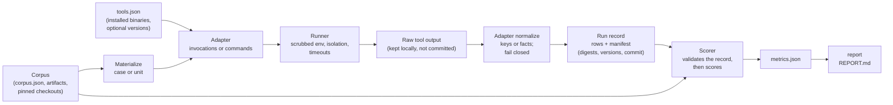

# Harness architecture

How the three live ShadowBench harnesses turn a corpus and a set of installed
tools into scored, reportable results, and what each step records so the
result can be checked later. The module docstrings named below are the
normative reference; this page is a map of them, not a replacement.

**Contents**

- [At a glance](#at-a-glance)
- [The shared pipeline](#the-shared-pipeline)
- [Cases track: `tools/shadowbench/cases`](#cases-track-toolsshadowbenchcases)
- [Estate track: `tools/shadowbench/estate`](#estate-track-toolsshadowbenchestate)
- [Code-surface discovery: `tools/discovery_benchmark`](#code-surface-discovery-toolsdiscovery_benchmark)
- [How the three harnesses differ](#how-the-three-harnesses-differ)
- [Historical harnesses](#historical-harnesses)
- [Where the rules live](#where-the-rules-live)

## At a glance

| | Cases track | Estate track | Code-surface discovery |
|---|---|---|---|
| Package | [`tools/shadowbench/cases/`](../tools/shadowbench/cases/README.md) | [`tools/shadowbench/estate/`](../tools/shadowbench/README.md) | [`tools/discovery_benchmark/`](../tools/discovery_benchmark/README.md) |
| Entry point | `python -m tools.shadowbench cases <command>` | `python -m tools.shadowbench estate <command>` | `python -m tools.discovery_benchmark <command>` |
| Design and results | [cases README](../benchmarks/shadowbench/cases/README.md) | [estate README](../benchmarks/shadowbench/estate/README.md) | [discovery README](../benchmarks/shadow-ai-discovery/README.md) |
| Unit of work | one tool on one generated case | one tool on one estate unit (`estate`, `code:<repo>`, `home:<device>`, `sim`) | one tool on one pinned repository |
| Truth unit | entity key per surface (`app:`, `caller:`, `artifact:`, `proc:` ...) | entity with facts and anchors | `<category>:<value>` fact |
| Run record | `manifest.json` plus one `<tool>.jsonl` per tool | `runs.json` | `runs.json` |
| Isolation | namespaces, uid/gid 65534, `no_new_privs` (needs root) | scrubbed environment, optional `setpriv` | scrubbed environment, optional `setpriv` |
| Binds results to inputs | corpus SHA-256, generator digest, per-file `rows_sha256`, harness commit | freeze manifest digest, drift after run, harness commit | none beyond the recorded tool versions and policy |

`python -m tools.shadowbench` with no arguments lists the two ShadowBench
tracks ([`tools/shadowbench/__main__.py`](../tools/shadowbench/__main__.py));
`python -m tools.shadowbench.cases` and `python -m tools.shadowbench.estate`
are the same entry points.

None of these harnesses is a sandbox. Each runs third-party binaries on the
operator's machine. Run tools only on a disposable, externally isolated host
with no credentials; scoring and reporting committed results need no
third-party tool at all. See [threat-model.md](threat-model.md).

## The shared pipeline

All three harnesses follow the same shape. They differ in what isolates the
tool, what binds a result to its inputs, and how the scorer treats a run that
did not finish.

1. **Corpus.** The truth and the inputs. Cases are generated from rubrics and
   rebuilt by `verify`; the estate is frozen by SHA-256 in `FREEZE.json`;
   code-surface repositories are pinned by commit.
2. **Adapter.** One module per tool. It declares what the tool handles,
   returns the processes to run, and maps the tool's own output onto the
   corpus's keys or facts. It never interprets findings beyond the tool's
   report and never executes the tool itself.
3. **Runner.** Executes the adapter's processes with a rebuilt environment
   and a timeout, with the isolation described per track below, and keeps the
   tool's raw output on the machine that ran it.
4. **Normalization.** The adapter reads the raw output. A crash, timeout,
   missing report, empty or unparsable output is an error, never an empty
   clean result.
5. **Run record.** Normalized rows plus a manifest naming the inputs, tool
   versions and, in the current runners, the harness commit and digests.
6. **Scorer.** Refuses a record that does not match its inputs (per track
   rules below), then computes metrics. It needs no third-party tool.
7. **Report.** Renders `metrics.json` as Markdown, including any override the
   scorer was forced to accept.

## Cases track: `tools/shadowbench/cases`

### Module map

| Module | Role |
|---|---|
| [`contract.py`](../tools/shadowbench/cases/contract.py) | Surfaces, modalities, the materialized case layout under `inputs/`, entity keys, labels, and the `Adapter` protocol (`Invocation`, `RunResult`, `AdapterResult`, `ToolEnv`, `base_env`, `relative_artifact`) |
| [`corpus.py`](../tools/shadowbench/cases/corpus.py) | The case model; validates case inputs on load; `corpus_digest` |
| `families/` | Entity families and their rubrics, one module per surface |
| [`generate.py`](../tools/shadowbench/cases/generate.py) | Builds a corpus at a seed; records the generator digest |
| [`verify.py`](../tools/shadowbench/cases/verify.py) | Rebuilds the cases from the current sources and compares them with a stored corpus |
| [`runner.py`](../tools/shadowbench/cases/runner.py) | Materializes cases, stages each (tool, case) run, writes rows and `manifest.json` |
| [`stage.py`](../tools/shadowbench/cases/stage.py) | What runs inside the namespaces for one adapter on one case |
| [`mockserv.py`](../tools/shadowbench/cases/mockserv.py) | Loopback HTTP services for `network/active` cases |
| [`score.py`](../tools/shadowbench/cases/score.py) | Validates the run record and computes entity-, case- and estate-level metrics |
| [`report.py`](../tools/shadowbench/cases/report.py) | Renders `metrics.json` as Markdown |
| [`fetch_code.py`](../tools/shadowbench/cases/fetch_code.py) | Fetches the 26 pinned code-surface repositories with hardened `git` calls |
| `adapters/` | One module per tool, each exporting `ADAPTER`; `registry.py` loads them; `_probe.py` runs version probes |
| [`install_tools.sh`](../tools/shadowbench/cases/install_tools.sh) | Installs the third-party tools at pinned versions or commits and writes `tools.json` |

### Commands

Every command is `python -m tools.shadowbench.cases <command>`
([`__main__.py`](../tools/shadowbench/cases/__main__.py)):

| Command | Flags (verified in code) | Notes |
|---|---|---|
| `generate` | `--seed` (default `20261011`), `--per-surface` (default 40), `--output` (required), `--stream-scheme {sha256,legacy}` (default `sha256`) | `legacy` only rebuilds the committed 2026-10-11 cases; under it the seed has no effect |
| `verify` | `--corpus` (required), `--regenerate` (accepted, changes nothing) | Always rebuilds and compares the parsed case lists; exit 1 names the first difference |
| `run` | `--corpus`, `--tools`, `--out` (required); `--only`, `--surfaces`, `--cases`, `--workers` (default 2), `--scratch`, `--checkouts` | Needs root, `unshare` and a `gcc` that can link a static binary |
| `score` | `--corpus`, `--results`, `--out` (required); `--reference` (default `shadowscan`), `--force` | Exit 2 with `refusing to score: ...` when the run record does not vouch for the rows |
| `report` | `--corpus`, `--metrics`, `--out` (required) | Lists any forced override at the top |

`fetch_code` is a module of its own, not a subcommand:
`python -m tools.shadowbench.cases.fetch_code DEST`, run from the repository
root.

### Data flow

1. `generate` draws entity families per surface and modality from its own
   random stream and renders each case's platform-native files. The corpus
   header records the seed and a digest over the generator sources.
2. `run` loads the corpus, refuses unsafe case or checkout ids (they must
   match `[A-Za-z0-9._-]+`), loads every adapter module in `adapters/`
   (a module that fails to import is skipped and recorded under
   `skipped_adapters`), and for each chosen tool calls `unavailable_reason`.
   A tool with a reason is recorded as `{"skipped": reason}`.
3. For each (tool, case) the runner creates
   `<scratch>/<tool>-<case>-XXXX/` (mode 0711) with `work/` (handed to
   uid/gid 65534) and `control/` (root only), materializes the case into
   `work/case/`, asks the adapter for its `Invocation`s, and starts
   `stage.py` in fresh namespaces. A case on a surface and modality the
   adapter does not declare gets an `unsupported` row without running.
4. After the stage exits, the runner takes `work/` back for root, removes
   hard links, FIFOs, sockets and device nodes, then symlinks that lead out
   of `work/`, and only then calls the adapter's `normalize`.
5. Exit codes are checked against each invocation's `ok_codes`. A run that
   exits outside them with no entities is an `error`; one that still reported
   entities keeps them and is flagged `incomplete`. A timeout or stage error
   is an `error`. For `runtime/live`, reported pids are translated to the
   corpus's `proc:<index>` keys; pids of harness or self processes are
   ignored and counted in the note.
6. Each row goes to `<out>/<tool>.jsonl`; the raw output (run results and the
   adapter's `raw`) goes to `<out>/raw/<tool>/<case>.json.gz`.
7. `manifest.json` is written last, with each tool's version, row-status
   counts and `rows_sha256`.

### Isolation

The stage runs as root under
`unshare --net --pid --fork --kill-child --mount --propagation private --mount-proc --ipc`.
Before anything from the case runs it:

- checks that it is init of a fresh PID namespace and not in the runner's
  mount namespace;
- sets `no_new_privs` and brings loopback up;
- mounts an empty tmpfs over `/root` and `/home`, and a fresh, empty,
  world-writable tmpfs over `/var/tmp` and `/dev/shm`;
- leaves its starting directory for `/`;
- serves the case's mock services, bound to `127.0.0.1` whatever the case
  says ([`mockserv.py`](../tools/shadowbench/cases/mockserv.py));
- spawns the case's inert processes, a static binary built once with
  `gcc -O2 -static` that sleeps until killed, under the recorded names and
  command lines, as uid/gid 65534 with a fixed minimal environment;
- runs each invocation as uid/gid 65534 with no supplementary groups and
  exactly the environment the invocation declares (`base_env` builds one from
  scratch with a case-local `HOME`, the fixed `PATH`, telemetry opt-outs and
  no inherited variable).

After each invocation, and on a timeout, the stage stops every process in the
namespace with one `kill(-1, SIGSTOP)`, kills and reaps everything except
itself and the inert processes (including descendants that left the process
group with `setsid`), and records the case as an error if any process
survives.

Version probes run outside the stage, once per tool, through
[`adapters/_probe.py`](../tools/shadowbench/cases/adapters/_probe.py): a
fixed `PATH`, a throwaway `HOME`, an empty stdin, a timeout, and, because the
runner is root, an empty network namespace, a fresh PID namespace, `/root`
and `/home` hidden and a drop to uid/gid 65534 with `no_new_privs`. A probe
that cannot drop privileges does not run and records `unknown`. A `version`
string in the tool's `tools.json` entry is recorded as given instead, without
a probe.

**Stated limits** ([`stage.py`](../tools/shadowbench/cases/stage.py)
docstring): this is not a filesystem sandbox. A tool can still read whatever
is world-readable outside `/root` and `/home`, and the host's `/tmp`, which
usually holds the scratch directory, stays shared with the host and with
other cases. The 2026-10-11 rows were recorded under weaker isolation (tools
and inert processes as root, host file system in view); see the cases
README's [Integration changes](../benchmarks/shadowbench/cases/README.md#integration-changes).

### Output files

**`manifest.json`** (written by the current runner):

| Field | Meaning |
|---|---|
| `started`, `finished` | UTC timestamps |
| `harness_commit` | The harness checkout's `HEAD`, null when git cannot name it |
| `harness_dirty` | Whether anything under `tools/` differs from that commit, untracked files included; null when unknown |
| `corpus`, `corpus_sha256` | Corpus path as given and the SHA-256 of the file |
| `generator_digest` | The digest recorded in the corpus header |
| `platform`, `python`, `workers`, `cases` | Host and run shape |
| `tools.<name>` | `tool`, `version`, `seconds`, `statuses` (row-status counts) and `rows_sha256`, or `{"skipped": reason}` |
| `skipped_adapters` | Adapter modules that failed to import |

The committed 2026-10-11 manifest predates `harness_commit`, `harness_dirty`
and `rows_sha256`; its rows are bound to it only by their status counts.

**`<tool>.jsonl`**, one row per case in corpus order:

| Field | Meaning |
|---|---|
| `tool`, `case`, `surface`, `modality`, `family`, `label`, `difficulty` | Identity of the row; the scorer refuses a row whose identity disagrees with its case or file |
| `status` | `ok`, `error` or `unsupported` |
| `entities` | List of `{kind, key, label[, attributes]}`; `label` is `agent`, `llm` or `ai` |
| `note` | Adapter and runner notes (counts, removed links, accepted-code violations) |
| `out_of_taxonomy` | Code surface only: hits the adapter dropped because they map to no fact |
| `seconds` | Sum of the invocations' wall-clock seconds |
| `incomplete` | The tool said it did not read everything, or it exited outside the accepted codes but still reported entities |

**`metrics.json`** top-level keys: `corpus_sha256`, `corpus_sha256_now`,
`corpus_mismatch_forced`, `forced`, `rows_unbound`, `generator_digest`,
`manifest`, `tool_runs`, `surfaces`, `tools`. Each tool carries `version`,
`surfaces_supported`, `coverage`, `withheld_decoys`, `in_scope`, `estate`
and `by_surface`; `in_scope` holds the confusion counts, precision, recall
and specificity with Wilson intervals, F1 with a bootstrap interval, the
agent-tier figures, the `case` block (case-level counts, balanced accuracy,
MCC) and timings. [metrics.md](metrics.md) defines each figure.

### What the scorer enforces

From the [`score.py`](../tools/shadowbench/cases/score.py) module docstring:

- **Refused unless `--force`:** a manifest whose `corpus_sha256` is not the
  SHA-256 of the corpus being scored (case ids are positional); a
  `<tool>.jsonl` for a tool the manifest does not record as run; row
  statuses that do not add up to the counts the manifest recorded; a file
  whose SHA-256 is not its recorded `rows_sha256`; an adapter module that
  does not load. A forced score lists every override in `metrics.json`
  (`forced`, `corpus_mismatch_forced`) and at the top of the report.
- **Refused even with `--force`:** an unknown status, a second row for a
  case, a case the corpus does not have, a row whose tool, surface, modality,
  family, label or difficulty disagrees with its file or case, a malformed
  `out_of_taxonomy` count or one outside the code surface, an `unsupported`
  row beside `ok` or `error` rows on the same surface and modality, and a
  malformed `withheld_decoys` declaration.
- **`rows_unbound`:** tools whose manifest entry has no `rows_sha256`, so
  their rows are bound only by status counts that an edited or swapped file
  can keep. The 2026-10-11 run is in this state for every tool.
- **Fail-closed outcomes:** an error or missing row never earns a true
  negative; an incomplete row keeps its true and false positives but never
  earns a true negative. See [metrics.md](metrics.md).

## Estate track: `tools/shadowbench/estate`

### Module map

| Module | Role |
|---|---|
| [`corpus.py`](../tools/shadowbench/estate/corpus.py) | Corpus model, estate walk (refuses symlinks and special files), freeze digests and drift |
| [`taxonomy.py`](../tools/shadowbench/estate/taxonomy.py) | Surfaces and fact categories; the code surface reuses the code-surface taxonomy |
| [`runner.py`](../tools/shadowbench/estate/runner.py) | Freeze check, per-unit private estate copies, command execution, `runs.json` |
| [`simhost.py`](../tools/shadowbench/estate/simhost.py) | Loopback mock Ollama and vLLM endpoints for the AI-Infra-Guard live-sim unit |
| [`score.py`](../tools/shadowbench/estate/score.py) | Attribution, run completeness, entity- and value-level metrics, shadow layer |
| [`report.py`](../tools/shadowbench/estate/report.py) | Renders `metrics.json` as Markdown |
| `adapters/` | `Adapter` protocol in `__init__.py`; explicit list in `registry.py`; shared helpers in `common.py` (client-name mapping, refusing launcher shims) |

### Commands

Every command is `python -m tools.shadowbench.estate <command>`
([`__main__.py`](../tools/shadowbench/estate/__main__.py)). `--corpus`,
`--estate` and `--freeze` default to the committed
`benchmarks/shadowbench/estate/` paths.

| Command | Flags (verified in code) | Notes |
|---|---|---|
| `validate` | `--corpus`, `--estate`, `--strict` | Checks the corpus, artifacts, unit directories, grounded primary anchors and the absence of symlinks or special files; prints a `WARN` per anchor collision (12 on the committed corpus); `--strict` makes them fail |
| `freeze` | `--corpus`, `--estate`, `--out` | Writes the SHA-256 freeze manifest; never refresh a committed freeze to hide drift |
| `verify-freeze` | `--corpus`, `--estate`, `--freeze` | Checks every frozen file |
| `run` | `--tools`, `--out` (required); `--corpus`, `--estate`, `--freeze`, `--workers` (default 4), `--timeout` (default 900 s per command), `--as-user`, `--keep-network`, `--only` | Exit 1 with `DRIFT` lines when the estate does not match the freeze before or after the run |
| `score` | `--runs`, `--out` (required); `--corpus`, `--estate`, `--freeze`, `--allow-missing-services`, `--allow-freeze-mismatch` | Exit 2 without writing when a recorded freeze no longer holds or a needed `services.json` is missing, unless the matching override is given |
| `report` | `--metrics`, `--out` (required); `--corpus`, `--title` | |

A `corpus error` (malformed corpus, manifest or run row, symlink or special
file in the estate) exits 2.

### Data flow

1. `run` compares the estate and `corpus.json` with `FREEZE.json` and
   refuses to start on any difference.
2. For each adapter in [`adapters/registry.py`](../tools/shadowbench/estate/adapters/registry.py)
   (an explicit list, unlike the cases track's module discovery), it records
   either `tools_skipped[id] = reason` or `tool_versions[id] = version(cfg)`,
   then asks `units()` for the units to run: `estate` (whole estate),
   `code:<repo>`, `home:<device>` or `sim` (the live-sim).
3. Each unit runs against its own copy of the estate in a fresh temporary
   directory; that copy must match the frozen digests before its commands
   start. Commands run with the unit's output directory
   (`<out>/<tool>/<unit slug>/`) as working directory.
4. `normalize(unit, out_dir)` returns `Prediction`s: a taxonomy fact, the
   text used for attribution, the adapter's surface placement and an optional
   registry verdict (`shadow`).
5. After the matrix, the source estate is checked again; any drift is
   recorded in `runs.json` and `run` exits 1.

### Execution and isolation

The estate runner reuses the code-surface runner's scrubbed environment (see
the estate README's [Execution and isolation](../benchmarks/shadowbench/estate/README.md#execution-and-isolation)):

- an environment rebuilt from scratch: a `PATH` of any `extra_path` entries
  from `tools.json` followed by `/usr/bin:/bin`, a private `HOME` and
  `TMPDIR` per unit, telemetry opt-outs, and `HTTP(S)_PROXY` pointing at a
  dead proxy (`http://127.0.0.1:9`) unless `--keep-network`;
- stdin at `/dev/null`, each command in its own process group, killed on
  timeout; captured stdout and stderr cut at 5,000,000 bytes, and a report
  captured under its own file name that hits the limit fails the command;
- refusing shims for common MCP server launchers (`npx`, `npm`, `node`,
  `uvx`, `pipx`, `python3`, `docker` and others, `common.LAUNCHERS`) first on
  `PATH` for the Cisco MCP Scanner and Snyk Agent Scan wrappers;
- with `--as-user ACCOUNT`, commands run through `setpriv` as that account;
  scratch directories are mode 0711; before anything reads what the account
  wrote, both trees are taken back and every symlink, hard link and special
  file is removed without being followed.

**This is not a sandbox.** There are no namespaces: a tool can read
anything its account can read, the dead proxy only stops clients that honour
proxy variables, and version probes run before the matrix as the invoking
account with its own environment. The 2026-10-11 run did not use `--as-user`
and predates the launcher shims.

### Output files

**`runs.json`** (current runner): `started`, `finished`, `harness_commit`,
`harness_dirty` (tracked files under `tools/` only; untracked files are not
checked), `freeze` (`sha256` of the freeze manifest file, `files`,
`drift_after`), `policy` (`timeout`, `as_user`, `path`, `extra_path`,
`keep_network`), `workers`, `tool_versions`, `tools_skipped` and `results`.
Each result row has `tool`, `unit`, `status` (`ok`, `failed`, `timeout`,
`skipped`, `error`), `seconds`, `predictions`, `raw_count`, `commands`,
`error`, `detail`, `incomplete`, `estate_changes` (files the tool changed in
its private copy, at most 50) and `removed_outputs`. The committed
2026-10-11 `runs.json` predates `harness_commit`, `harness_dirty`, `freeze`,
`estate_changes` and `removed_outputs`.

**`metrics.json`** has `corpus`, `run` and `tools`. Each tool carries `name`,
`version`, `surfaces`, `runs`, `units`, `complete`, `incomplete_units`,
`commands`, `seconds`, `entity_level`, `estate_wide`, `value_level`,
`shadow_layer`, `predictions` (including `harness_attributed` and
`unknown_scan_target` counts), `multi_match`, `unattributed` and
`per_entity`.

### What the scorer enforces

From the [`score.py`](../tools/shadowbench/estate/score.py) docstring and the
estate README's [Reproduce](../benchmarks/shadowbench/estate/README.md#reproduce):

- For a run that records a freeze: nothing drifted during the run, the
  freeze manifest has the digest the run recorded, and the corpus and estate
  being scored still match it. Otherwise exit 2 without writing, unless
  `--allow-freeze-mismatch`, in which case `run.freeze_problems` and the
  report list what failed.
- A `sim` run, or a run that records scan targets, needs
  `services/services.json`; without it `score` exits 2 unless
  `--allow-missing-services`, which leaves every scan target unattributed.
- A malformed `harness_commit`, `harness_dirty` or `freeze` record, a row
  without a tool or a valid unit, or a second row for the same tool and unit
  is a `corpus error` (exit 2), with or without overrides.
- Attribution, run completeness and the metrics follow the estate README's
  [Scoring](../benchmarks/shadowbench/estate/README.md#scoring) section.

## Code-surface discovery: `tools/discovery_benchmark`

### Module map and commands

| Command | Module | Flags (verified in code) |
|---|---|---|
| `fetch` | `fetch.py` | `--corpus`, `--dest` (required), `--verify` |
| `evidence` | `evidence.py` | `--checkouts`, `--out` (required), `--all`, `--repo-dir` |
| `run` | `runner.py` | `--corpus`, `--tools`, `--checkouts`, `--out` (required); `--as-user`, `--workers` (default 4), `--timeout` (default 900), `--only`, `--repos`, `--keep-network` |
| `renormalize` | `runner.py` | `--out` (run directory holding `runs.json`) |
| `score` | `score.py` | `--corpus`, `--runs`, `--out` (required); `--repos` |
| `compare` | `compare.py` | `--corpus`, `--baseline`, `--current` (required); `--baseline-runs`, `--repos`, `--tools`, `--f1-tolerance` (default 0.01), `--out` |
| `report` | `report.py` | `--corpus`, `--metrics`, `--out` (required); `--title` |

[`taxonomy.py`](../tools/discovery_benchmark/taxonomy.py) defines the
`<category>:<value>` facts and the alias tables every adapter maps onto, and
is shared by the ground-truth extractor and every adapter.
`adapters/registry.py` lists the adapters explicitly. The estate track reuses
this package's environment scrubbing, `ToolConfig` and code-surface adapters.

### Isolation

Per the [`runner.py`](../tools/discovery_benchmark/runner.py) docstring and
the discovery README's [Isolation and fairness](../benchmarks/shadow-ai-discovery/README.md#isolation-and-fairness):
a rebuilt environment (no API keys, a dead proxy for clients that honour it,
telemetry opt-outs, a private `HOME` and `TMPDIR`), a per-command timeout,
and with `--as-user` a `setpriv` wrapper. It is not a filesystem or network
sandbox; the operator must make the checkouts read-only and run third-party
tools only on an externally isolated runner with egress disabled.

### Output files

`runs.json` holds `started`, `finished`, `host` (`platform`, `python`,
`cpus`), `policy`, `tool_versions`, `tools_skipped`, `workers` and `results`.
Each result has `tool`, `repo`, `status` (`ok`, `failed`, `timeout`,
`skipped`, `error`), `seconds`, `facts`, `raw_count`, `commands`, `error` and
`detail` (ShadowScan's adapter sets `detail.incomplete` for an exit-3 scan).
`metrics.json` holds `corpus`, `run` and `tools`; each tool carries `name`,
`version`, `categories`, `runs`, `incomplete_runs`, `seconds`, `repo_level`,
`value_level`, `category_level` and `per_repo`.

`runs.json` records neither a corpus digest nor a harness commit, and the
scorer does not check one. Identify the corpus and harness from the
repository history and record both commits with any new run (see
[submitting-results.md](submitting-results.md)).

### Regression gate

`compare` exits 1 when a tool's in-scope value-level F1 falls by more than
`--f1-tolerance`, when repository-level recall falls at all, when a control
or near-miss repository the baseline left clean is flagged, or when a
repository whose run was complete in the baseline is incomplete now.
Improvements never fail it. The weekly workflow that runs it for ShadowScan
alone lives in ShadowScan:
[`.github/workflows/benchmark.yml`](https://github.com/aisecnomad/Nexus-ShadowScan/blob/main/.github/workflows/benchmark.yml).
Details: the discovery README's [Regression gate](../benchmarks/shadow-ai-discovery/README.md#regression-gate).

## How the three harnesses differ

| Property | Cases | Estate | Code-surface discovery |
|---|---|---|---|
| Needs root | yes (namespaces) | no | no |
| Tool identity | uid/gid 65534, `no_new_privs` | invoking account, or `--as-user` via `setpriv` | invoking account, or `--as-user` via `setpriv` |
| Network | empty namespace; loopback mocks only | dead proxy unless `--keep-network` | dead proxy unless `--keep-network` |
| Host homes | `/root` and `/home` hidden | visible | visible |
| Incomplete run | keeps its true and false positives, never earns a true negative | unscored: expected facts missed, no true negative | scored on the facts it found, flagged `incomplete` |
| `harness_dirty` | counts untracked files under `tools/` | tracked files only | not recorded |
| `tools.json` shape | `{tool_root, tools: {<name>: {bin, version?, ...}}}`, names hyphenated (`snyk-agent-scan`) | `{extra_path, tools: {<id>: {bin, ...}}}`, ids underscored (`mcp_scan`) | `{extra_path, empty_home?, tools: {<id>: {bin, ...}}}` |
| ShadowScan entry | Python interpreter plus `repo` (put on `PYTHONPATH`) | installed `shadowscan` binary | installed `shadowscan` binary |

Numbers from one harness are not comparable with another's: the tool lists,
versions, units and scoring rules differ. The cases track's ShadowScan
`repo` must point at a ShadowScan checkout, which in this companion is a
separate checkout from the harness (for example `scanner-source/`, see the
[repository README](../README.md)); the historical reproduce block in the
[cases harness README](../tools/shadowbench/cases/README.md#reproduce)
assumes the older single-repository layout.

## Historical harnesses

These were imported byte for byte from ShadowScan and are kept for
provenance. Their results are historical; read each README's limits before
citing them.

| Harness | What it is | Caution |
|---|---|---|
| [`tools/benchmark/`](../tools/benchmark/README.md) | Synthetic head-to-head: 900 seeded cases across repo, endpoint and network surfaces, plus the 34-repository real-world cohort ([`benchmarks/realworld/`](../benchmarks/realworld/README.md)) | Generator-defined labels |
| [`tools/benchmark/realworld/`](../tools/benchmark/realworld/README.md) | 326 sampled GitHub and GitLab repositories, deterministic oracle plus model adjudication | `freeze.py` hashes `<repo root>/shadowscan` |
| [`tools/benchmark_realworld/`](../tools/benchmark_realworld/README.md) | Repo and home-view surfaces, two model labelers, protocols v1 and v2 | `run.py` records a code hash and checkout `HEAD` of the repository it sits in |
| [`benchmarks/sab_realworld/`](../benchmarks/sab_realworld/README.md) | 130 authored cases modelled on public repository layouts, run with ShadowScan's `code.filesystem` connector | Without `--output`, `python -m benchmarks.sab_realworld` rewrites the committed `results/` in place; always pass a new `--output` |
| [`tools/shadowbench450_archive.py`](../tools/shadowbench450_archive.py) | Arithmetic and consistency check of the [ShadowBench-450 archive](../benchmarks/shadowbench-450/README.md) | Data only; a pass is arithmetic-only verification, never verified detection performance |

**Run the legacy self-hashing helpers only in the pinned scanner checkout.**
`tools/benchmark/realworld/freeze.py` records the SHA-256 of
`<repository root>/shadowscan` and the repository's git state, and
`tools/benchmark_realworld/run.py` records the code hash and `HEAD` of the
repository it runs from. They assume the scanner and harness share one
repository root. In this companion there is no `shadowscan/` directory, so
run from here they would hash an empty scanner tree and record the
companion's commit as if it were a scanner revision. Reproduce those commands
in a checkout of ShadowScan at
`0792106b8d2cc09517f7f4ee2eeabf4f8eb8da2d`, where that layout exists. Their
source bytes are bound by `MIGRATION.json`, so they are not changed here;
see the [repository README](../README.md).

## Where the rules live

The docstrings are the reference, in this order of precedence for each
track: the scorer's module docstring, the runner's, the adapter package's
`__init__.py`, then each adapter's own docstring (version, command line,
output-to-key mapping, calibration notes). Track READMEs describe the design,
the committed runs and their disclosures. When this page and a docstring
disagree, the docstring and the code win; please open an issue.
